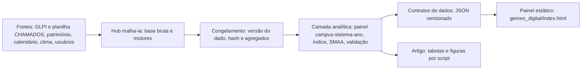

# Arquitetura

## 1. Camadas

1. Fontes: planilha CHAMADOS (alimentada pelo GLPI), planilha de patrimônio imobiliário, e, em versões futuras, calendário, precipitação, usuários, datas de solução e prioridade do GLPI, laudos de inspeção.
2. Hub (`malha-ia`): guarda a base bruta e executa os motores; é a única fonte da base de chamados. O painel não duplica `chamados.json`.
3. Congelamento: cada geração do painel registra o hash (SHA-256) e o tamanho do arquivo de chamados lido, a data de geração e a versão do código; para o artigo, um release arquivado com identificador persistente (ver `docs/auditoria/06_PLANO_DE_EXECUCAO.md`).
4. Camada analítica (`scripts/replicacao/`): lê o dado congelado e gera somente agregados; a pontuação, o SMAA e a validação existem em Python versionado e testado, e não apenas em JavaScript.
5. Contratos de dados: `gemeo_digital/dados/gemeo.json` e `dados.js` com estrutura documentada em `04_CONTRATOS_DE_DADOS.md`.
6. Apresentação: página estática (HTML, CSS e JavaScript sem dependências externas) que funciona sem servidor; os gráficos são SVG gerados no navegador, sem biblioteca de gráficos, o que elimina dependência de CDN e facilita auditoria e impressão.
7. Governança: versão e limites sempre visíveis; avisos obrigatórios; sem texto livre; decisão de publicação com o autor.

## 2. Decisões de projeto e justificativas

1. Estático e sem servidor: reduz custo e superfície de ataque e permite arquivar o painel junto com o artigo; a atualização ocorre por regeneração dos dados.
2. Dados embutidos em `dados.js`: funciona em `file://` (sem bloqueio de requisições locais) e evita falha por permissão de rede.
3. SVG próprio: controle de acessibilidade, de cores seguras para daltonismo e de exportação vetorial; a troca por biblioteca é possível se a complexidade crescer.
4. Cálculo no gerador: a incerteza (SMAA, 4.000 sorteios com semente fixa) é pré-calculada para que o resultado seja determinístico e testável; o navegador apenas recalcula postos para o cenário de pesos escolhido.
5. Agregados apenas: o gerador lê o arquivo de chamados, mas só grava contagens, proporções e somas por campus, sistema e ano.
6. Contrato versionado: o painel só lê campos conhecidos, e testes verificam o contrato.

## 3. Automação futura (não implementada)

1. Workflow semanal no repositório do eixo para regenerar `gemeo_digital/dados/` a partir do snapshot público do hub, com testes de contrato antes do commit; exige o mesmo cuidado de concorrência dos demais workflows de sincronização.
2. Aviso de dado antigo: o painel deve sinalizar quando `gerado_em_utc` passar de um limite.
3. Liberação por tag: a versão do artigo usa dado congelado e não a atualização contínua.
4. Nenhum segredo é necessário no nível L0; níveis seguintes (extração do GLPI) exigirão credenciais fora do repositório e decisão institucional.

## 4. Privacidade e segurança

1. Sem texto livre, sem identificadores de chamado, sem dados pessoais; apenas agregados com contagem suficiente (alternativas com poucos chamados devem ser suprimidas ou agrupadas; limiar a definir com o encarregado de dados).
2. Teste automatizado impede a gravação de campos não previstos no contrato.
3. A publicação do painel não deve expor rankings de unidades sem autorização (seção 5 de `05_ROADMAP_E_RISCOS.md`).
